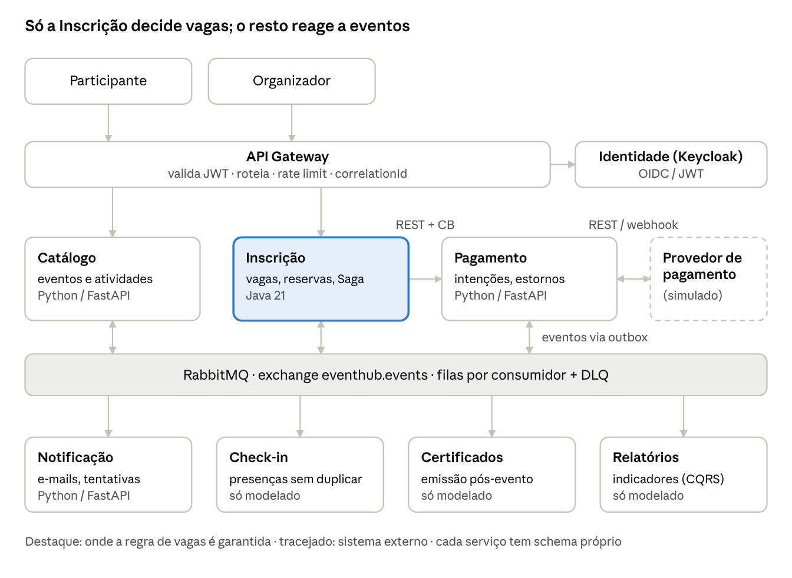
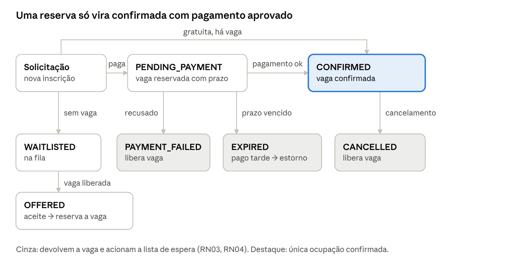

# EventHub — Relatório Arquitetural (Trabalho 2)

19/10/2026

## Resumo da proposta

Propomos **8 serviços**: 7 de negócio + um provedor de identidade pronto (Keycloak), atrás de um API Gateway e integrados por um broker de mensagens. A decisão central é manter **Inscrição e Capacidade no mesmo serviço**, porque a regra "sem overbooking" (RN01/RQ04) precisa de atomicidade local. Tudo o que não é crítico para a inscrição (notificação, certificados, relatórios, check-in) reage a eventos e pode cair sem afetar a operação principal.

Na Parte 2 implementamos 4 desses serviços em 2 tecnologias: **Inscrição em Java 21** e **Catálogo, Pagamento e Notificação em Python**. Eles usam PostgreSQL (um schema por serviço) e RabbitMQ. Os demais serviços ficam apenas modelados. Os 14 testes de validação passaram, incluindo 200 tentativas simultâneas para 30 vagas sem overbooking (seções 9 e 10).

**Divisão da apresentação (06/11):**

| Integrante     | Apresenta                                       | Seções |
|----------------|-------------------------------------------------|--------|
| José Waldeney  | Problema, forças, decomposição e diagramas      | 1 a 4  |
| Renan Teixeira | Comunicação, padrões, fluxo pago e ADRs         | 5 a 8  |
| João Carlos    | Demonstração ao vivo, testes e reflexão crítica | 9 a 11 |

## 1. Forças e atributos de qualidade

Quatro forças definem as fronteiras: picos de 20× em inscrições, a regra de não haver overbooking, serviços periféricos que não podem bloquear o núcleo e a integração entre duas tecnologias. Cada RQ abaixo vira uma decisão concreta, seguindo o raciocínio da aula: força → atributo → fronteira → consequência.

| RQ                           | Força                                                      | Decisão arquitetural                                                                              | Custo aceito                                                          |
|------------------------------|------------------------------------------------------------|---------------------------------------------------------------------------------------------------|-----------------------------------------------------------------------|
| RQ01 Evolução independente   | Notificações e certificados mudam em ritmo próprio         | Serviços separados, acoplados só por eventos versionados                                          | Mais deploys e contratos para manter                                  |
| RQ02 Escalabilidade seletiva | Catálogo e Inscrição recebem 20×; Certificados fica ocioso | Catálogo e Inscrição escalam por réplicas; cache na leitura do catálogo                           | Cache pode mostrar vagas desatualizadas (a verdade fica na Inscrição) |
| RQ03 Disponibilidade         | Notificações e relatórios podem cair                       | Comunicação assíncrona para tudo que não é crítico                                                | Consistência eventual nos relatórios e e-mails                        |
| RQ04 Consistência            | Sem overbooking; reserva→pagamento→confirmação recuperável | Capacidade dentro da Inscrição com update atômico; Saga orquestrada; Outbox                       | Saga tem mais estados e compensações para testar                      |
| RQ05 Interoperabilidade      | Java e Python precisam conversar                           | REST com OpenAPI + eventos JSON com schema versionado                                             | Disciplina de versionamento de contratos                              |
| RQ06 Observabilidade         | Rastrear uma inscrição entre serviços                      | correlationId em headers HTTP e em todo evento; OpenTelemetry + Jaeger                            | Mais um componente de infraestrutura                                  |
| RQ07 Segurança               | Acesso autenticado; segredos fora do repositório           | Keycloak (OIDC/JWT), validação no Gateway, autorização por dono em cada serviço; .env fora do git | Configuração inicial do Keycloak                                      |
| RQ08 Operabilidade           | Reproduzível localmente                                    | Docker Compose com tudo; um PostgreSQL com um schema por serviço                                  | Ambiente local pesado (≈ 10 containers)                               |

## 2. Capacidades e decomposição

Os 11 RFs viram 8 serviços. Agrupamos o que compartilha invariante ou ciclo de vida, e separamos o que tem carga, ritmo de mudança ou tolerância a falha diferentes.

| Serviço               | RFs / RNs             | Responsabilidade                                                             | Por que é um serviço próprio                                                          | Carga                            |
|-----------------------|-----------------------|------------------------------------------------------------------------------|---------------------------------------------------------------------------------------|----------------------------------|
| Identidade (Keycloak) | RF01, RN07            | Cadastro, login, papéis, organizações do organizador                         | Segurança é transversal e não é diferencial do negócio: usamos um produto pronto      | Média                            |
| Catálogo de Eventos   | RF02, RF03, RF04      | Eventos, atividades, programação, busca pública                              | Evento e atividade são o mesmo agregado e o mesmo dono (organizador); leitura intensa | Alta (leitura)                   |
| Inscrição             | RF05, RF06, RN01–RN04 | Inscrições, vagas, reservas, lista de espera, orquestração da inscrição paga | É a fronteira de consistência: a vaga e a inscrição mudam na mesma transação          | Alta (escrita)                   |
| Pagamento             | RF07, RN02, RN03      | Intenções de pagamento, integração com provedor externo, webhooks, estornos  | Isola a dependência externa instável e os dados financeiros                           | Média                            |
| Notificação           | RF08, RN05            | Templates, envio, tentativas, reenvio                                        | RQ01 e RQ03: muda com frequência e não pode bloquear nada                             | Pico após inscrições, assíncrono |
| Check-in              | RF09                  | Presença, sem duplicidade                                                    | Pico no dia do evento; deve funcionar mesmo com a Inscrição fora (projeção local)     | Pico no dia                      |
| Certificados          | RF10, RN06            | Elegibilidade, emissão, validação de certificado                             | RQ01 e RQ02: quase ocioso, roda após o evento, muda o layout com frequência           | Baixa                            |
| Relatórios            | RF11                  | Indicadores de inscrições, pagamentos, ocupação, presença                    | Modelo de leitura próprio (CQRS); pode cair sem afetar nada                           | Baixa                            |

Infraestrutura (não são serviços de negócio): API Gateway, broker RabbitMQ, PostgreSQL, Jaeger e um **mock do provedor de pagamento**, que representa o sistema externo.

### Critérios de granularidade

1.  **Invariante forte fica dentro de um serviço.** Vaga e inscrição não podem ficar separadas sem lock distribuído.
1.  **Perfis de carga diferentes separam.** Certificados e Relatórios não escalam junto com Inscrição.

2.  **Tolerância a falha diferente separa.** O que pode falhar sem afetar a inscrição fica do outro lado de um evento.

3.  **Mesmo agregado e mesmo dono juntam.** Evento, atividade e programação são editados juntos pelo organizador.

4.  **Tamanho da equipe limita.** Com 3 pessoas, cada serviço a mais é um deploy, um schema e um contrato a mais.

### Alternativas avaliadas e rejeitadas

| Alternativa                                 | Por que rejeitamos                                                                                                              |
|---------------------------------------------|---------------------------------------------------------------------------------------------------------------------------------|
| Serviço de Capacidade separado da Inscrição | Exigiria lock distribuído ou Saga só para reservar uma vaga; a chamada remota fica no caminho com mais processamento do sistema |
| Programação separada de Eventos             | Mesmo agregado e mesmo dono; geraria chamadas síncronas constantes entre os dois                                                |
| Serviço de Busca separado                   | Sem requisito de busca textual avançada; réplicas + cache resolvem o pico. Fica como evolução (CQRS com Elasticsearch)          |
| "Comunicação & Certificados" juntos         | Cargas opostas: notificação reage em tempo real ao pico, certificado roda em lote após o evento                                 |
| Check-in dentro da Inscrição                | Acopla o dia do evento ao serviço mais carregado; com projeção local, o check-in funciona mesmo com a Inscrição fora            |
| Monólito modular                            | Seria adequado para 3 pessoas, mas não atende RQ01/RQ02 nem o objetivo do trabalho. Registrado como alternativa no ADR-01       |

## 3. Diagramas de contexto e de containers

A faixa de cima é o contexto (atores e o provedor externo); o restante são os containers. Setas sólidas entre caixas são REST; tudo que passa pela faixa do RabbitMQ é evento.

contexto + containers · 8 serviços, 1 broker, 1 sistema externo

O caminho síncrono do usuário para em, no máximo, Gateway → Inscrição → Pagamento. Check-in, Certificados e Relatórios também têm REST pelo Gateway (omitido para não poluir), mas recebem seus dados só por eventos. No relatório, vale separar em duas figuras: contexto (C4 nível 1) e containers (C4 nível 2).

## 4. Propriedade dos dados

Cada serviço é dono exclusivo do seu schema; nenhum serviço lê tabela de outro. Quem precisa de um dado alheio consulta a API do dono ou mantém uma **projeção local** alimentada por eventos. Localmente usamos um único PostgreSQL com um schema e um usuário por serviço, sem permissão cruzada (ownership, não tecnologia).

| Serviço      | Dados próprios (autoritativo)                                                                         | Projeções locais (cópia, eventual)                           | Expõe via                                                          |
|--------------|-------------------------------------------------------------------------------------------------------|--------------------------------------------------------------|--------------------------------------------------------------------|
| Identidade   | usuário, papel, organização, vínculo organizador↔organização                                          | —                                                            | OIDC/JWT (claims sub, roles, orgs)                                 |
| Catálogo     | evento, atividade (horário, local, preço, capacidade **configurada**, regras)                         | contagem de vagas restantes (para exibir)                    | REST + eventos ActivityPublished/Updated/Cancelled, EventCancelled |
| Inscrição    | inscrição e seu estado, activity_seats (capacidade, reservadas, confirmadas), lista de espera, outbox | atividade (capacidade, preço, prazo de reserva, grátis/paga) | REST + eventos Registration\*, SeatsChanged                        |
| Pagamento    | pagamento, tentativas, referência do provedor, estornos, outbox                                       | —                                                            | REST + eventos PaymentConfirmed/Declined/Expired/Refunded          |
| Notificação  | template, envio, tentativas, mensagens processadas                                                    | e-mail/nome do destinatário (vem no evento)                  | só consome eventos                                                 |
| Check-in     | presença (única por inscrição+atividade)                                                              | inscrições confirmadas por atividade                         | REST + evento AttendanceRecorded                                   |
| Certificados | certificado emitido, código de validação, regra de elegibilidade                                      | presenças, fim da atividade                                  | REST (download/validação) + CertificateIssued                      |
| Relatórios   | nenhum dado autoritativo                                                                              | tabelas agregadas por evento/atividade                       | REST (somente leitura)                                             |

**Quem é autoritativo pelas vagas restantes?** A Inscrição. O Catálogo é dono da capacidade *configurada*; quando o organizador muda a capacidade, o Catálogo publica ActivityUpdated e a Inscrição ajusta activity_seats. O número exibido na busca é uma projeção e pode atrasar alguns segundos; a decisão de aceitar uma inscrição nunca usa esse número.

**Políticas de acesso (RN07):** participante só consulta inscrições/certificados com participantId = sub do token. Organizador só altera eventos cuja organizationId está nas claims orgs. Cada serviço aplica a regra no seu próprio dado; o Gateway só garante que o token é válido.

## 5. Comunicação, contratos e idempotência

Regra geral: **síncrono quando o usuário precisa da resposta agora; assíncrono quando é uma reação a algo que já aconteceu.** Evitamos cadeias síncronas: nenhuma requisição do usuário atravessa mais de dois serviços.

| Interação                                          | Estilo                          | Motivo                                              | Tratamento de erro                                                                   |
|----------------------------------------------------|---------------------------------|-----------------------------------------------------|--------------------------------------------------------------------------------------|
| Cliente → Gateway → Catálogo (consulta)            | REST síncrono                   | Resposta imediata, cacheável                        | Timeout 2 s; cache serve se o serviço estiver lento                                  |
| Cliente → Gateway → Inscrição (inscrever/cancelar) | REST síncrono                   | Usuário precisa saber se tem vaga                   | 409 sem vaga / 202 com lista de espera; Idempotency-Key obrigatório                  |
| Inscrição → Pagamento (criar intenção)             | REST síncrono + Circuit Breaker | Usuário precisa do link de pagamento                | Timeout 2 s, 1 retry com mesma chave; circuito aberto → libera a vaga e responde 503 |
| Provedor externo → Pagamento (webhook)             | REST síncrono (externo)         | Imposto pelo provedor                               | Deduplica por providerTransactionId; responde 200 mesmo se repetido                  |
| Pagamento → Inscrição (resultado)                  | Evento                          | Desacopla o tempo do provedor do tempo da inscrição | Outbox + consumidor idempotente                                                      |
| Inscrição → Notificação, Relatórios, Check-in      | Evento (pub/sub)                | Reações; podem estar fora                           | Fila durável, retry com backoff, DLQ após 5 tentativas                               |
| Catálogo → Inscrição (capacidade, preço)           | Evento                          | Inscrição não depende do Catálogo no caminho quente | Projeção local; evento fora de ordem resolvido por version                           |

### Envelope de evento (contrato comum Java ↔ Python)

{  
"eventId": "uuid",  
"type": "RegistrationConfirmed",  
"version": 1,  
"occurredAt": "2026-11-06T14:00:00Z",  
"producer": "registration-service",  
"correlationId": "uuid da requisição original",  
"payload": { "registrationId": "…", "activityId": "…", "participantId": "…" }  
}

Exchange eventhub.events do tipo *topic*; routing key = type. Cada consumidor tem a própria fila. Mudança incompatível = novo version, publicado em paralelo até os consumidores migrarem.

### APIs principais

| Serviço      | Endpoints                                                                                                                                      |
|--------------|------------------------------------------------------------------------------------------------------------------------------------------------|
| Catálogo     | GET /events, GET /events/{id}, GET /activities/{id}, POST /events, PATCH /events/{id}, POST /events/{id}/publish, POST /events/{id}/activities |
| Inscrição    | POST /registrations, GET /registrations/{id}, GET /me/registrations, DELETE /registrations/{id}                                                |
| Pagamento    | POST /payments (interno), GET /payments/{id}, POST /webhooks/provider                                                                          |
| Check-in     | POST /activities/{id}/checkins, GET /activities/{id}/checkins                                                                                  |
| Certificados | GET /me/certificates, GET /certificates/{code}/validate                                                                                        |
| Relatórios   | GET /reports/events/{id}                                                                                                                       |

Todos documentados em OpenAPI 3 e publicados no repositório.

### Idempotência

- **Comandos HTTP:** POST /registrations e POST /payments exigem Idempotency-Key. A segunda chamada com a mesma chave devolve a resposta original.

- **Eventos:** entrega é *at-least-once*. Cada consumidor grava eventId em processed_messages na mesma transação do efeito; se já existe, ignora.

- **Máquina de estados:** a Inscrição só aceita CONFIRMAR a partir de PENDING_PAYMENT. Um PaymentConfirmed repetido não tem efeito.

- **Check-in:** restrição UNIQUE (registration_id, activity_id) impede presença duplicada (RF09).

## 6. Padrões avaliados

Adotamos 9 padrões, cada um ligado a uma força; 5 foram avaliados e deixados de fora. Referência: [microservices.io/patterns](https://microservices.io/patterns/).

| Padrão                               | Decisão     | Onde                                            | Força que justifica                                                   | Custo                                |
|--------------------------------------|-------------|-------------------------------------------------|-----------------------------------------------------------------------|--------------------------------------|
| API Gateway                          | Adotado     | Entrada única (Spring Cloud Gateway ou Traefik) | RQ07 validação de token, roteamento, rate limit no pico (RQ02)        | Ponto único; precisa de réplica      |
| Database per Service                 | Adotado     | Todos (schema por serviço)                      | RQ01 evolução independente                                            | Sem JOIN entre serviços; projeções   |
| Saga (orquestrada)                   | Adotado     | Inscrição paga, orquestrada pela Inscrição      | RN02, RN03, RQ04                                                      | Estados e compensações a testar      |
| Transactional Outbox                 | Adotado     | Inscrição e Pagamento                           | Evento Confirmed não pode se perder (RN05, RQ04)                      | Tabela + relay; duplicatas possíveis |
| Idempotent Consumer                  | Adotado     | Todos os consumidores                           | Entrega at-least-once do outbox/broker                                | Tabela processed_messages            |
| Publish/Subscribe                    | Adotado     | RabbitMQ topic exchange                         | RQ03: Notificação/Relatórios fora não bloqueiam                       | Consistência eventual                |
| Circuit Breaker + Timeout            | Adotado     | Inscrição → Pagamento; Pagamento → provedor     | Provedor externo lento não pode travar threads da Inscrição no pico   | Ajuste de limiares                   |
| CQRS (leve)                          | Adotado     | Relatórios; vagas exibidas no Catálogo          | RF11 e RQ02: leitura separada da escrita                              | Dado atrasado alguns segundos        |
| Distributed Tracing + Correlation ID | Adotado     | Todos                                           | RQ06                                                                  | Um container a mais (Jaeger)         |
| Service Discovery                    | Não adotado | —                                               | DNS do Docker Compose já resolve nomes                                | Revisar se for para Kubernetes       |
| Choreography Saga                    | Não adotado | —                                               | Fluxo de pagamento tem um dono claro; coreografia espalharia o estado | —                                    |
| Event Sourcing                       | Não adotado | —                                               | Nenhum requisito de auditoria/replay que justifique                   | —                                    |
| Backend for Frontend                 | Não adotado | —                                               | Um único cliente web no escopo                                        | —                                    |
| Two-Phase Commit                     | Rejeitado   | —                                               | Bloqueia sob falha e não é suportado pelo broker                      | —                                    |

## 7. Fluxo completo: inscrição paga

A vaga é reservada antes do pagamento e só vira confirmada quando o pagamento é aprovado; qualquer outro desfecho devolve a vaga. A Inscrição orquestra a Saga e guarda o estado.

estados da inscrição · 8 estados

Toda transição acontece numa transação local da Inscrição, junto com o ajuste de activity_seats e o registro na outbox.

### Caminho feliz

1.  Participante consulta a atividade: GET /activities/{id} (Catálogo, via cache).
1.  Participante envia POST /registrations com Idempotency-Key. O Gateway valida o JWT.
1.  A Inscrição executa, numa única transação local:

    - UPDATE activity_seats SET reserved = reserved + 1 WHERE activity_id = ? AND reserved + confirmed \< capacity — se afetar 0 linhas, não há vaga (409 ou lista de espera);
    - INSERT registration (status = PENDING_PAYMENT, hold_expires_at = now() + prazo);
    - INSERT outbox (RegistrationPending).
1.  A Inscrição chama POST /payments (timeout 2 s, Circuit Breaker, chave = registrationId). O Pagamento cria a intenção no provedor simulado e devolve o link.
1.  Resposta ao participante: 201 com status = PENDING_PAYMENT e o link de pagamento.
1.  O provedor chama POST /webhooks/provider com *aprovado*. O Pagamento grava o resultado + outbox PaymentConfirmed na mesma transação.
1.  A Inscrição consome PaymentConfirmed: reserved − 1, confirmed + 1, status CONFIRMED, outbox RegistrationConfirmed.
1.  Notificação envia o e-mail; Relatórios e Check-in atualizam suas projeções. Tudo assíncrono.

Atividade gratuita: os passos 4–7 não existem; o passo 3 já faz confirmed + 1 e grava CONFIRMED.

### Falhas e comportamento esperado

| Cenário                                      | O que acontece                                                                                                                                         | Regra        |
|----------------------------------------------|--------------------------------------------------------------------------------------------------------------------------------------------------------|--------------|
| Pagamento recusado                           | Pagamento publica PaymentDeclined → Inscrição: reserved − 1, status PAYMENT_FAILED, oferece a vaga à lista de espera                                   | RN03         |
| Participante não paga (timeout do negócio)   | Job da Inscrição (a cada 30 s) libera reservas com hold_expires_at vencido → status EXPIRED, publica RegistrationExpired; Pagamento cancela a intenção | RN02         |
| Pagamento aprovado **depois** da expiração   | Inscrição tenta reservar de novo; se não houver vaga, publica RefundRequested e o Pagamento estorna (compensação)                                      | RN02, RQ04   |
| Serviço de Pagamento fora ou lento (passo 4) | Timeout/circuito aberto → Inscrição libera a vaga na hora e responde 503 – tente novamente. Se a intenção chegou a ser criada, ela expira sozinha      | RQ03, RQ04   |
| Provedor externo fora                        | Pagamento responde erro rápido (circuito próprio); mesmo efeito da linha acima                                                                         | RQ03         |
| Webhook duplicado                            | Pagamento deduplica por providerTransactionId; evento repetido é ignorado pela máquina de estados                                                      | Idempotência |
| Broker fora                                  | Eventos ficam na outbox; o relay reenvia quando o broker volta. Nada se perde                                                                          | RQ04         |
| Notificação fora                             | Mensagens acumulam na fila; inscrição continua CONFIRMED                                                                                               | RN05, RQ03   |
| Relatórios fora                              | Nenhum impacto; ao voltar, consome a fila e se atualiza                                                                                                | RQ03         |
| 200 pessoas disputando 30 vagas              | O UPDATE condicional serializa no banco; no máximo 30 reservas têm sucesso                                                                             | RN01         |
| Cancelamento de inscrição confirmada         | confirmed − 1; se houver lista de espera, o primeiro recebe oferta com prazo (OFFERED) e a vaga fica reservada para ele                                | RN04         |

## 8. ADRs

Cinco decisões, no formato pedido: contexto, alternativas, decisão, evidências, justificativa e consequências. As evidências marcadas "Parte III" serão produzidas nos testes.

### ADR-01 — Inscrição e Capacidade no mesmo serviço, com update condicional atômico

- **Contexto:** RN01/RQ04 proíbem overbooking mesmo com 20× de carga. Ler "vagas restantes" e depois inserir permite que várias requisições vejam a mesma vaga.
- **Alternativas:** (a) serviço de Capacidade separado com lock distribuído; (b) contador atômico em Redis; (c) SELECT … FOR UPDATE na linha da atividade; (d) lock otimista com version; (e) monólito modular.
- **Decisão:** a Inscrição é dona de activity_seats e reserva com UPDATE … WHERE reserved + confirmed \< capacity na mesma transação que cria a inscrição.
- **Evidências:** slide "No overbooking: where is the invariant enforced?"; teste de 200 requisições para 30 vagas (Parte III).
- **Justificativa:** o invariante fica numa única fronteira transacional. (a) coloca uma chamada remota no caminho mais quente; (b) cria uma segunda fonte de verdade; (d) gera muitos conflitos e retries sob pico; (c) funciona, mas segura lock por mais tempo.
- **Consequências:** a linha da atividade vira ponto de contenção em eventos muito disputados (aceitável na escala do trabalho). O Catálogo não é mais a fonte das vagas restantes.

### ADR-02 — REST síncrono para comandos e consultas; eventos via RabbitMQ para reações

- **Contexto:** RQ03 e RN05 exigem que notificação e relatórios não bloqueiem a inscrição. RQ05 exige contratos explícitos entre Java e Python.
- **Alternativas:** (a) tudo REST; (b) tudo por eventos, inclusive a inscrição; (c) Kafka em vez de RabbitMQ; (d) gRPC entre serviços.
- **Decisão:** REST + OpenAPI quando o usuário espera resposta; eventos JSON com envelope versionado, num exchange topic do RabbitMQ, para tudo que reage a um fato.
- **Evidências:** slide "Choosing sync vs async for EventHub"; teste com Notificação parada (Parte III).
- **Justificativa:** (a) faz a Notificação fora derrubar a inscrição; (b) obriga o usuário a fazer polling para saber se tem vaga. RabbitMQ tem filas por consumidor, DLQ e retry prontos, e sobe fácil no Compose; Kafka é desnecessário sem replay ou alto volume. gRPC dificultaria a depuração e o contrato com o navegador.
- **Consequências:** consistência eventual em e-mails, relatórios e check-in; precisamos de idempotência e DLQ.

### ADR-03 — Saga orquestrada pela Inscrição para a inscrição paga

- **Contexto:** RN02/RN03 exigem confirmar só após pagamento e liberar a vaga em recusa ou expiração. Não há transação ACID entre Inscrição e Pagamento.
- **Alternativas:** (a) Two-Phase Commit; (b) Saga coreografada; (c) orquestrador dedicado (serviço próprio ou Temporal/Camunda); (d) Saga orquestrada dentro da Inscrição.
- **Decisão:** (d). A Inscrição mantém a máquina de estados PENDING_PAYMENT → CONFIRMED \| PAYMENT_FAILED \| EXPIRED, com compensações: liberar vaga e, em pagamento tardio, pedir estorno.
- **Evidências:** slides "Saga is not a distributed ACID transaction" e "Ask: can a simpler single-owner workflow meet the same forces?"; testes de recusa e expiração (Parte III).
- **Justificativa:** o fluxo tem só dois participantes e um dono natural. (a) bloqueia sob falha; (b) espalharia o estado; (c) adiciona um serviço e uma ferramenta sem ganho para 3 pessoas.
- **Consequências:** a Inscrição conhece o Pagamento (acoplamento aceito). Precisa de job de expiração e de testes para cada transição.

### ADR-04 — Database per Service com Transactional Outbox e consumidor idempotente

- **Contexto:** RQ01 pede evolução independente; RQ04 pede que o evento RegistrationConfirmed nunca se perca. Gravar no banco e publicar no broker são operações que falham separadamente.
- **Alternativas:** (a) banco compartilhado; (b) *dual write* (grava e publica em sequência); (c) CDC com Debezium; (d) outbox com relay por polling.
- **Decisão:** um schema e um usuário por serviço no mesmo PostgreSQL local; Inscrição e Pagamento gravam o evento na tabela outbox na mesma transação e um relay publica a cada 1 s. Consumidores deduplicam por eventId.
- **Evidências:** slides "Database per service is about ownership" e "Events, idempotency and the outbox problem"; teste parando o RabbitMQ durante inscrições (Parte III).
- **Justificativa:** (a) cria acoplamento de schema; (b) perde eventos se o processo cair entre as duas operações; (c) é robusto, mas pesado para o ambiente local.
- **Consequências:** atraso de até ≈ 1 s na publicação; eventos podem chegar duplicados. Um PostgreSQL único é ponto único de falha no ambiente local (não em produção).

### ADR-05 — API Gateway + Keycloak (OIDC/JWT), autorização por dono em cada serviço

- **Contexto:** RF01, RN07 e RQ07 pedem autenticação, papéis e isolamento por organização, em serviços Java e Python.
- **Alternativas:** (a) serviço de usuários próprio emitindo JWT; (b) cada serviço autentica sozinho; (c) sessão no Gateway; (d) Keycloak + validação de JWT no Gateway e nos serviços.
- **Decisão:** (d). Keycloak emite tokens com sub, roles e orgs; o Gateway rejeita token inválido; cada serviço verifica se o recurso pertence ao usuário ou à organização.
- **Evidências:** RQ07; teste em que um organizador tenta editar evento de outra organização (Parte III).
- **Justificativa:** autenticação não é diferencial do negócio e é fácil de errar; Keycloak tem bibliotecas para Spring e FastAPI. A autorização fica no serviço porque só ele sabe quem é dono do dado.
- **Consequências:** mais um container pesado; segredos do Keycloak vão em .env fora do git, com .env.example no repositório.

## 9. Parte 2 — Implementação

Implementamos o fluxo de inscrição paga de ponta a ponta com 4 serviços, 2 tecnologias e 3 mecanismos de consistência e resiliência. Tudo sobe com docker compose up --build (instruções no README do repositório).

| Serviço        | Tecnologia                                      | Porta | O que demonstra                                                                                              |
|----------------|-------------------------------------------------|-------|--------------------------------------------------------------------------------------------------------------|
| Inscrição      | Java 21 (HTTP do JDK + JDBC + cliente RabbitMQ) | 8080  | Reserva atômica de vaga, Saga orquestrada com compensação, Outbox, Circuit Breaker, Idempotency-Key          |
| Catálogo       | Python / FastAPI                                | 8001  | Atividades, login de demonstração (JWT), regra de organizador (RN07)                                         |
| Pagamento      | Python / FastAPI                                | 8002  | Provedor externo simulado (tok_ok, tok_declined, tok_slow), idempotência por inscrição, cancelamento/estorno |
| Notificação    | Python (consumidor pika)                        | 8003  | Consumidor idempotente, fila durável, DLQ, reconexão automática                                              |
| Infraestrutura | PostgreSQL 16, RabbitMQ 3                       | —     | Um schema e um usuário por serviço; exchange topic eventhub.events                                           |

**Fluxo integrado (4 serviços):** Inscrição consulta o Catálogo (REST, só na primeira vez) → reserva a vaga com UPDATE … WHERE reserved + confirmed \< capacity → chama o Pagamento (REST, timeout 2 s, Circuit Breaker) → confirma ou libera a vaga → grava o evento na outbox na mesma transação → relay publica no RabbitMQ → Notificação consome.

**Mecanismos escolhidos e por quê:**

1.  **Update condicional atômico + CHECK no banco** — atende RN01. O CHECK (reserved + confirmed \<= capacity) é uma segunda barreira: mesmo um bug no código não grava overbooking.
1.  **Saga orquestrada com compensação** — atende RN02/RN03. Recusa ou timeout liberam a vaga; se o pagamento já tinha sido criado, a Inscrição pede o cancelamento ao Pagamento.
1.  **Transactional Outbox + publisher confirms + mandatory** — atende RN05. O evento só é marcado como publicado depois que o broker confirma e roteia para alguma fila.
1.  **Circuit Breaker próprio** (70 linhas) — abre após 5 falhas seguidas, fica 15 s aberto e testa com uma chamada (HALF_OPEN).
1.  **Correlation ID** — o header X-Correlation-Id atravessa Java → Python → evento → consumidor (RQ06).

**Contratos:** OpenAPI gerado pelo FastAPI (/docs) para Catálogo e Pagamento; docs/openapi-registration.yaml para a Inscrição; docs/eventos.md para o envelope e os 3 eventos.

**Front de demonstração (web, porta 3000):** uma página HTML/JS servida por nginx. O nginx também roteia /api/\<serviço\>/ para cada serviço, funcionando como gateway simplificado. A aba "Inscrição ao vivo" mostra as vagas atualizadas e uma linha do tempo de cada requisição por serviço, com o mesmo correlationId. A aba "Serviços e APIs" mostra o status de cada serviço, os endpoints, os links para o Swagger e o contrato dos eventos.

**Recortes do protótipo em relação ao desenho (seções 2 a 8):**

| Desenho                                             | Protótipo                                                                        | Justificativa                                                                                       |
|-----------------------------------------------------|----------------------------------------------------------------------------------|-----------------------------------------------------------------------------------------------------|
| Keycloak (OIDC) + API Gateway                       | JWT HS256 emitido pelo Catálogo; nginx do front como gateway simples (só roteia) | Prazo. Validação do token e regra de dono (RN07) continuam ativas em cada serviço                   |
| Pagamento por webhook assíncrono                    | Pagamento síncrono com timeout                                                   | O provedor simulado responde na hora; o job de expiração (a cada 10 s) cobre falhas no meio da Saga |
| Spring Boot                                         | Java 21 sem framework                                                            | Sem dependências pesadas; cada mecanismo fica explícito no código                                   |
| Lista de espera, Check-in, Certificados, Relatórios | Apenas modelados                                                                 | Não mudam as decisões de consistência demonstradas                                                  |
| Jaeger / OpenTelemetry                              | Correlation ID nos logs                                                          | Mesmo objetivo (RQ06) com menos infraestrutura                                                      |

## 10. Parte 3 — Validação

Os 14 testes automatizados passaram em 50 s. O cenário crítico também passou: 200 tentativas simultâneas para 30 vagas resultaram em exatamente 30 confirmações e 170 recusas 409, sem nenhuma vaga presa. Os testes chamam as APIs de fora, como um cliente faria (pytest tests -v -s). A saída completa está em evidencias/resultado-testes.txt.

| Exigência do enunciado       | Teste                                                     | Resultado observado                                                                                                      |
|------------------------------|-----------------------------------------------------------|--------------------------------------------------------------------------------------------------------------------------|
| Fluxo principal e estados    | Inscrição paga ponta a ponta                              | 201 CONFIRMED; pagamento APPROVED; vagas confirmed=1, reserved=0; e-mail registrado com o mesmo correlationId            |
| Fluxo principal e estados    | Gratuita, cancelamento, idempotência, inscrição duplicada | 201 sem pagamento; cancelamento devolve a vaga; mesma Idempotency-Key devolve a mesma inscrição; segunda inscrição → 409 |
| Concorrência                 | 200 × 30 vagas, atividade paga                            | {201: 30, 409: 170} em 1,9 s; final confirmed=30, reserved=0                                                             |
| Concorrência                 | 200 × 30 vagas, atividade gratuita                        | {201: 30, 409: 170} em 1,5 s                                                                                             |
| Falha de dependência         | Pagamento recusado                                        | 402 PAYMENT_FAILED (DECLINED); vaga volta e outra pessoa consegue se inscrever                                        |
| Falha de dependência         | Provedor lento (5 s)                                      | 503 em 2,1 s; vaga liberada; pagamento termina como CANCELLED, nunca cobrado                                             |
| Falha de dependência         | Notificação parada                                        | Inscrição 201 CONFIRMED; e-mail entregue quando o serviço voltou                                                         |
| Falha de dependência         | RabbitMQ parado                                           | Inscrição 201; evento ficou na outbox e foi publicado após o retorno do broker                                           |
| Falha de dependência         | Pagamento parado                                          | 6 respostas 503 em ≤ 0,1 s; circuito OPEN; após o retorno, HALF_OPEN → CLOSED e 201                                      |
| Integração entre tecnologias | Rastreamento por correlationId                            | Mesma requisição nos logs de Inscrição (Java), Pagamento e Notificação (Python)                                          |
| Segurança (RN07)             | Acesso cruzado e token forjado                            | Inscrição de outra pessoa → 403; sem token ou token forjado → 401; organizador de outra organização → 403                |

Trechos de log que comprovam os mecanismos (transições do circuito, outbox retida e retomada, compensação) estão em evidencias/logs-resiliencia.txt e evidencias/rastreamento-correlation-id.txt.

**Ambiente da execução registrada:** serviços rodando como processos locais (PostgreSQL 16, RabbitMQ 3.12, Python 3.13, Java 21); as falhas foram simuladas parando e religando cada processo. Com Docker, os mesmos testes usam docker compose stop/start. O grupo deve repetir a execução via Compose antes da entrega e substituir os arquivos de evidência.

**Não testado:** expiração de reserva por queda no meio da Saga (o job existe, mas o cenário exige derrubar a Inscrição entre a reserva e o pagamento).

## 11. Reflexão crítica: o que ganhamos e o que pagamos

Ganhamos isolamento de falhas e evolução independente onde o enunciado pedia. Em troca, pagamos com mais estados, mais código de infraestrutura e consistência eventual. A decisão que mais valeu foi a menos "distribuída": manter vaga e inscrição na mesma transação.

| Decisão                           | O que ganhamos (evidência)                                             | O que pagamos                                                                                             |
|-----------------------------------|------------------------------------------------------------------------|-----------------------------------------------------------------------------------------------------------|
| Vaga dentro da Inscrição (ADR-01) | Zero overbooking com 200 requisições simultâneas, sem lock distribuído | A linha da atividade vira ponto de contenção; o Catálogo deixa de ser a fonte das vagas                   |
| Eventos assíncronos (ADR-02)      | Notificação e broker fora não afetaram nenhuma inscrição               | O e-mail chega depois (consistência eventual); é preciso deduplicar e ter DLQ                             |
| Saga com compensação (ADR-03)     | Recusa e timeout nunca deixaram vaga presa nem cobrança indevida       | Cinco estados e transições guardadas por WHERE status = …; o caso "pagou depois de expirar" exige estorno |
| Outbox (ADR-04)                   | Nenhum evento perdido com o RabbitMQ parado                            | Atraso de até 0,5 s; entrega duplicada possível; um job a mais para operar                                |
| Timeout + Circuit Breaker         | Com o Pagamento fora, resposta em 0,05 s em vez de travar threads      | Ajustar limiares; durante 15 s, até pagamentos que funcionariam são recusados                             |
| Duas tecnologias                  | Contratos explícitos (OpenAPI, envelope de evento)                     | Duas toolchains, dois estilos de log, dois Dockerfiles                                                    |

**Latência:** uma inscrição paga cruza 3 serviços e 2 saltos de rede síncronos. Para manter o caminho curto, a capacidade e o preço ficam numa projeção local na Inscrição e o Catálogo só é consultado na primeira vez.

**Acoplamento que ficou:** a Inscrição conhece o Pagamento e espera a resposta dele. Uma mudança de capacidade no Catálogo não chega à projeção local; no desenho isso seria o evento ActivityUpdated, que não foi implementado.

**Um monólito modular teria bastado?** Para 3 pessoas e esta carga, provavelmente sim, e com menos custo operacional. Os microsserviços só se pagam com os requisitos RQ01–RQ03 (deploy independente, escala seletiva, isolamento de falhas). Foram justamente esses que os testes de falha demonstraram.

## 12. Declaração de uso de IA generativa

O grupo usou o Claude (Anthropic) como apoio. Ele foi usado para propor a decomposição, rascunhar os ADRs, gerar o código inicial dos serviços e dos testes, e redigir este relatório. O motivo foi o prazo curto para uma equipe de 3 pessoas. O grupo revisou as decisões, executou os testes e conferiu os resultados registrados em evidencias/. As referências abaixo foram verificadas.

## Checklist de entrega

- [x] Rodar docker compose up --build e pytest tests -v -s numa máquina do grupo e trocar os arquivos de evidencias/
- [x] Ensaiar python demo.py uma vez (≈ 5 min)
- [x] Publicar o repositório (GitHub) sem o arquivo .env
- [x] Exportar este relatório em PDF/Word

## Fontes

- Enunciado "Trabalho 2 — EventHub" e slides Wave 3 (SOA) e Wave 4 (Microservices) da disciplina
- [microservices.io — Pattern language](https://microservices.io/patterns/)
- Richardson, *Microservices Patterns* (2018); Newman, *Building Microservices*, 2ª ed. (2021)
